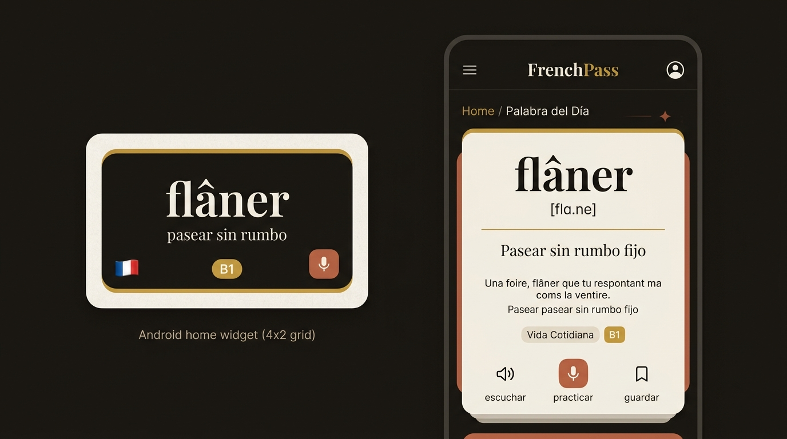
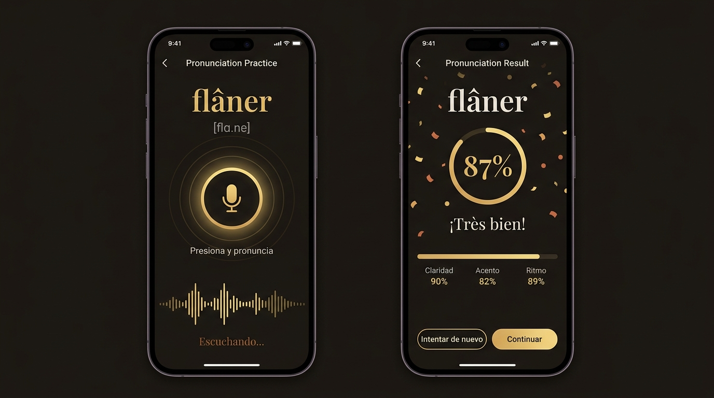
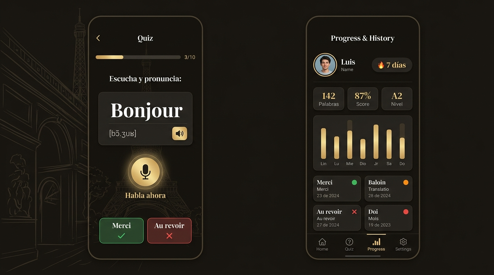

# FrenchPass — Mockups UI

## Pantallas Diseñadas

### 1. Widget Android + Pantalla Principal (Home)

**Widget (4x2)**: palabra, traducción, nivel, bandera, botón mic directo  
**Home**: tarjeta elegante con palabra, fonética IPA, traducción, frase de ejemplo, botones de acción

---

### 2. Práctica de Pronunciación + Resultado

**Práctica**: micrófono circular con anillo dorado pulsante, waveform animado, estado "Escuchando..."  
**Resultado**: score circular 87%, desglose (Claridad / Acento / Ritmo), feedback "¡Très bien!", confetti

---

### 3. Quiz de Pronunciación + Progreso e Historial

**Quiz**: barra de progreso 3/10, palabra con fonética, botón speaker, mic "Habla ahora", historial de respuestas recientes  
**Progreso**: racha de días, stats (palabras / score / nivel), gráfico semanal, historial de palabras con indicadores de color

---

## Design System

### Paleta de Colores

| Token | Valor | Uso |
|---|---|---|
| `colorPrimary` | `#2C2416` | Fondo principal oscuro |
| `colorSecondary` | `#C49A3C` | Dorado, acentos, CTAs |
| `colorAccent` | `#8B4513` | Terracota, errores suaves |
| `colorBackground` | `#1A1612` | Fondo nocturno profundo |
| `colorSurface` | `#2A2218` | Cards, modales |
| `colorTextPrimary` | `#F0EBE0` | Texto principal crema |
| `colorTextSecondary` | `#A89880` | Texto secundario, subtítulos |
| `colorSuccess` | `#4CAF82` | Pronunciación correcta |
| `colorError` | `#CF6679` | Pronunciación incorrecta |
| `colorGold` | `#C49A3C` | Score badges, highlights |

### Tipografía

| Rol | Fuente | Peso | Tamaño |
|---|---|---|---|
| Display (palabras FR) | Playfair Display | Bold | 48–64sp |
| Títulos | Playfair Display | SemiBold | 24–32sp |
| Cuerpo | Lato | Regular | 14–16sp |
| Fonética IPA | Crimson Pro | Italic | 16–18sp |
| Botones | Lato | SemiBold | 14sp |
| Labels | Lato | Medium | 12sp |

### Espaciado y Forma

- **Radius**: Cards `16dp`, Botones `12dp`, Chips `20dp`, Modal `24dp`
- **Spacing scale**: 4 / 8 / 12 / 16 / 24 / 32 / 48dp
- **Elevación**: Cards `4dp`, Modal `8dp`, FAB `12dp`

### Animaciones

| Elemento | Tipo | Duración |
|---|---|---|
| Entrada de página | Fade + Slide Up | 300ms |
| Botón micrófono activo | Pulse Ring (escala 1.0→1.15) | 800ms loop |
| Waveform | Bars animadas | 60fps real-time |
| Score circular | Arc draw | 600ms ease-out |
| Confetti en resultado | Particle fall | 1200ms |
| Widget update | Cross-fade | 200ms |
